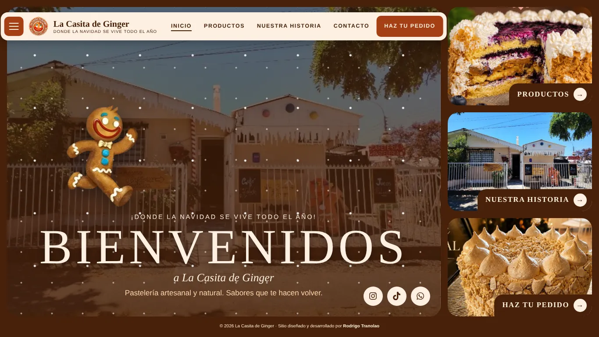
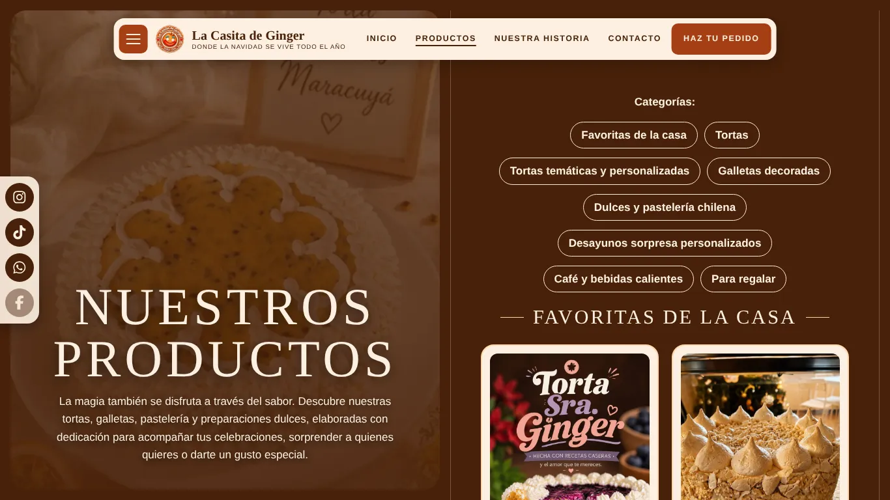
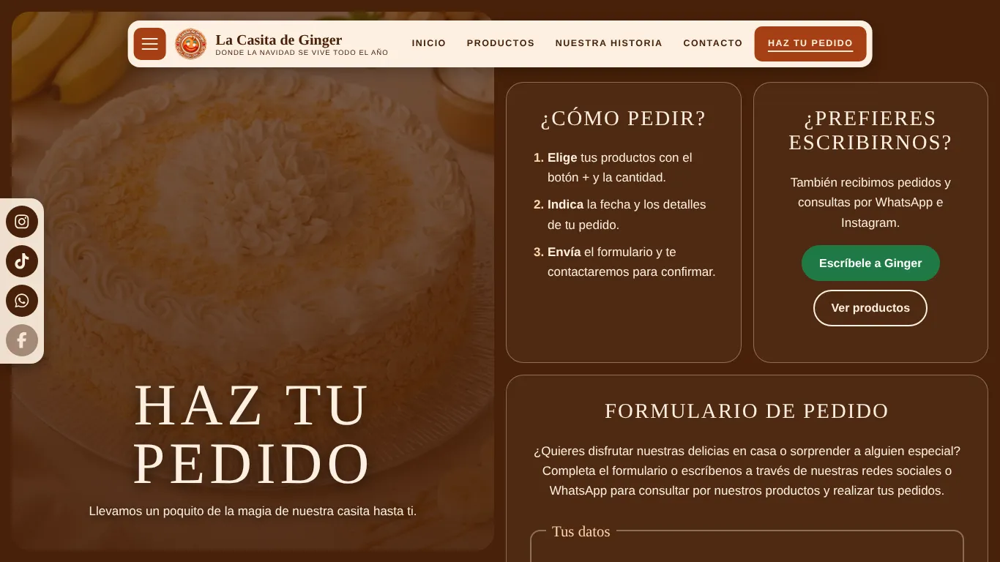
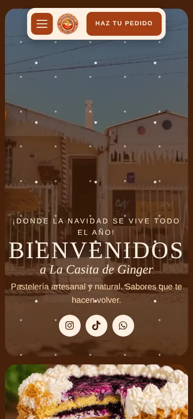
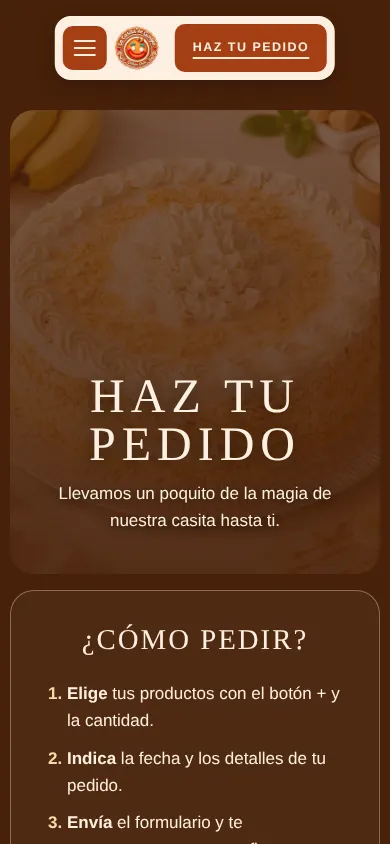
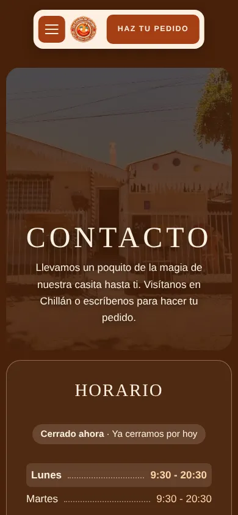

<div align="center">

# 🎄 La Casita de Ginger

**Sitio web para una pastelería artesanal de Chillán donde la Navidad se vive todo el año.**

[](https://la-casita-de-ginger.netlify.app/)


[**🔗 Ver el sitio**](https://la-casita-de-ginger.netlify.app/) · [Código fuente](la-casita-de-ginger/examen-final/public_html) · [Historial de evaluaciones](#-historial-del-proyecto)



</div>

---

## 📋 Contenido

- [Sobre el proyecto](#-sobre-el-proyecto)
- [Funcionalidades](#-funcionalidades)
- [Capturas](#-capturas)
- [Tecnologías](#-tecnologías)
- [Estructura del proyecto](#-estructura-del-proyecto)
- [Decisiones de diseño y desarrollo](#-decisiones-de-diseño-y-desarrollo)
- [Calidad y pruebas](#-calidad-y-pruebas)
- [Ejecución local y despliegue](#-ejecución-local-y-despliegue)
- [Historial del proyecto](#-historial-del-proyecto)
- [Autor](#-autor)

---

## 🍰 Sobre el proyecto

**La Casita de Ginger** es un emprendimiento de pastelería temática navideña ubicado en Chillán, Chile. Este sitio web le da presencia digital y permite a sus clientes conocer la historia del local, revisar la carta de productos y **armar su pedido en línea para enviarlo directamente por WhatsApp**.

El proyecto se desarrolló durante la asignatura **Diseño Web** (Escuela de Informática y Telecomunicaciones, IPLACEX), a partir de los requerimientos y antecedentes entregados por el emprendimiento.

| Objetivo | Cómo lo resuelve el sitio |
|---|---|
| Mostrar la identidad del emprendimiento | Diseño propio con la paleta, tipografías y mascota de la marca |
| Dar a conocer los productos | Carta organizada por categorías con visor de imágenes |
| Facilitar los pedidos | Formulario con carrito, validaciones y envío del detalle por WhatsApp |
| Informar horario y ubicación | Página de contacto con horario dinámico y mapa de ubicación |

---

## ✨ Funcionalidades

### Pedido en línea · [`js/pedido.js`](la-casita-de-ginger/examen-final/public_html/js/pedido.js)
- **Carrito dinámico:** al seleccionar productos y cantidades se genera un resumen en tiempo real con el total de unidades. Solo se consideran los productos marcados.
- **Validación del formulario:** nombre, correo, celular chileno (`+56 9`) y fecha de entrega (no anterior a hoy), con mensajes de error junto a cada campo.
- **Envío por WhatsApp:** al confirmar, se construye un mensaje con el detalle del pedido y se abre la conversación con el local.

### Horario en vivo · [`js/horario.js`](la-casita-de-ginger/examen-final/public_html/js/horario.js)
- Destaca el día actual y muestra si el local está **abierto ahora** o a qué hora abre/cierra.

### Comentarios (página Nosotros) · [`js/comentario.js`](la-casita-de-ginger/examen-final/public_html/js/comentario.js)
- Contador de caracteres, validación de campos y vista previa del comentario con calificación por estrellas.

### Experiencia de usuario
- Menú de navegación desplegable y accesos directos a redes sociales.
- Visor de imágenes (lightbox) en la carta de productos.
- Animaciones sutiles con temática navideña.
- Diseño **responsive** adaptado a celular, tablet y escritorio.

---

## 📸 Capturas

| Productos | Pedido |
|---|---|
|  |  |

**Versión celular**

| Inicio | Pedido | Contacto |
|---|---|---|
|  |  |  |

---

## 🛠 Tecnologías

| Área | Detalle |
|---|---|
| **HTML5** | Estructura semántica (`header`, `nav`, `main`, `section`, `aside`, `footer`), formularios accesibles con `label`, `fieldset` y atributos ARIA |
| **CSS3** | Variables (custom properties), Flexbox, Grid, `clamp()`, animaciones con `@keyframes` y media queries |
| **JavaScript** | Manipulación del DOM y eventos: `DOMContentLoaded`, `click`, `change`, `input`, `blur`, `submit` y `reset`; delegación de eventos |
| **Control de versiones** | Git y GitHub |
| **Despliegue** | Netlify (configurado en [`netlify.toml`](netlify.toml)) |

El sitio no usa frameworks ni librerías externas: todo está escrito con HTML, CSS y JavaScript nativos.

---

## 📁 Estructura del proyecto

```
la-casita-de-ginger/examen-final/public_html/
├── index.html            Inicio
├── nosotros.html         Historia, misión, visión y comentarios
├── productos.html        Carta de productos
├── pedido.html           Formulario de pedido
├── contacto.html         Horario y ubicación
├── plantilla-base.html   Página base para crear nuevas secciones
├── css/
│   ├── base.css          Variables de diseño, estilos generales y encabezado
│   ├── estructura.css    Menú, redes sociales y pie de página
│   ├── paginas.css       Estilos propios de cada página
│   ├── componentes.css   Tarjetas, formularios, visor, horario
│   └── responsive.css    Adaptación a celular y tablet
├── js/
│   ├── pedido.js
│   ├── horario.js
│   └── comentario.js
└── img/                  Imágenes optimizadas (JPG / WebP)
```

---

## 🎨 Decisiones de diseño y desarrollo

- **Diseño propio organizado como plantilla reutilizable.** Todas las páginas comparten la misma estructura (encabezado, menú, contenido, redes y pie), y `plantilla-base.html` sirve como punto de partida para agregar nuevas secciones.
- **CSS modular con variables.** Colores, tipografías y radios se definen una sola vez en `:root`, y los estilos se dividen en cinco archivos según su función. El orden de carga respeta la cascada.
- **JavaScript separado por funcionalidad.** Cada archivo se encarga de una sola tarea y se carga solo en la página que lo necesita.
- **Pedidos por WhatsApp.** Es el canal que el emprendimiento ya usa con sus clientes, por lo que no requiere un servidor ni base de datos.
- **Mejora progresiva.** El contenido sigue visible sin JavaScript y los formularios mantienen un envío alternativo por correo (`mailto`).

---

## ✅ Calidad y pruebas

- HTML y CSS validados con el **validador del W3C**, sin errores.
- Pruebas funcionales del carrito, validaciones, envío por WhatsApp, horario y comentarios.
- Revisión en anchos de **390, 768, 1024 y 1366 px**, sin desbordes horizontales ni errores en consola.
- Imágenes optimizadas en formato WebP para mejorar los tiempos de carga.

---

## 🚀 Ejecución local y despliegue

**En local**

```bash
git clone https://github.com/rodrigotrano/diseno-web.git
```

Luego abre `la-casita-de-ginger/examen-final/public_html/index.html` en el navegador. No requiere instalación ni dependencias.

**Despliegue**

El sitio se publica automáticamente en **Netlify** con cada cambio en la rama `main`. La carpeta publicada se define en [`netlify.toml`](netlify.toml).

---

## 🗂 Historial del proyecto

El repositorio conserva la evolución del sitio a lo largo de la asignatura:

| Etapa | Carpeta | Contenido |
|---|---|---|
| Evaluación 1 · HTML | [`ev1-html`](la-casita-de-ginger/ev1-html/public_html) | Estructura semántica, sin estilos |
| Evaluación 2 · CSS | [`ev2-css`](la-casita-de-ginger/ev2-css/public_html) | Hoja de estilos externa, Flexbox, Grid, animaciones y página de pedidos |
| Evaluación 3 · JavaScript | [`ev3-js`](la-casita-de-ginger/ev3-js/public_html) | CSS organizado como plantilla, funcionalidades con JavaScript y eventos |
| **Examen final** | [`examen-final`](la-casita-de-ginger/examen-final/public_html) | **Versión definitiva publicada en Netlify** |

---

## 👤 Autor

**Rodrigo Tranolao** — Diseño y desarrollo
Asignatura Diseño Web · IPLACEX · 2026

> Las imágenes, el logotipo y la información comercial pertenecen a **La Casita de Ginger** y se usan con fines académicos.
